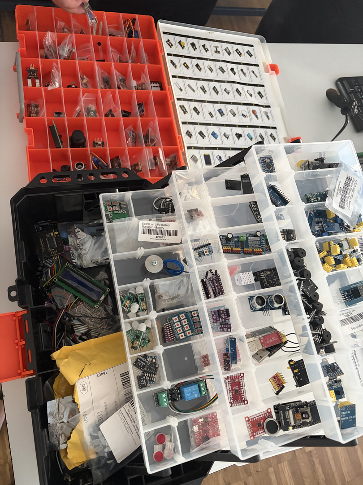

# 04B - Sensoren und Aktoren der Schule
**Anforderungen:** Sie haben sich mit den Sensoren und Aktoren der Schule auseinander gesetzt 
(Eintrag was es für Sensoren und Aktoren in der Schule zum Ausleihen hat.)
**KI-Deklaration:** Text wurde aus Stichworten/Notizen mit KI ausformuliert.

Es gibt viele Sensoren/Aktoren zur Auswahl, unter anderem:
- I2C 8×8 LED Dot Matrix
- 0802 LCD Module
- Rotary Encoder
- Joystick-Modul
- APDS-9930
- DHT11
- Tilt Sensor
- Servo-Motor

Sensoren erfassen Informationen aus der Umgebung und geben diese an einen Mikrocontroller weiter. Aktoren setzen dagegen Befehle des Mikrocontrollers sichtbar oder hörbar um. In der Ausleihe gibt es zum Beispiel den DHT11 zur Messung von Temperatur und Luftfeuchtigkeit, den APDS-9930 für Licht- und Abstandsmessungen sowie einen Tilt-Sensor, der eine Neigung erkennt. Mit dem Joystick-Modul und dem Rotary Encoder können Eingaben vorgenommen werden.

Zu den Aktoren gehören der Servo-Motor, der sich gezielt in eine bestimmte Position drehen lässt, die I2C-LED-Matrix zur Anzeige von Symbolen oder Texten und das 0802-LCD-Modul zur Darstellung von Messwerten und Informationen. Damit lassen sich Sensoren und Aktoren zu einem vollständigen IoT-Projekt verbinden: Ein Sensor misst einen Wert, der Mikrocontroller wertet ihn aus und steuert anschließend einen Aktor.

### Genauer angeschaut: TEMT6000 (KS0048)

Der TEMT6000 ist ein analoger Helligkeitssensor. Er misst die Lichtstärke in seiner Umgebung und gibt abhängig von der Helligkeit einen Messwert an den Mikrocontroller aus. Das KS0048-Modul enthält diesen Sensor und kann über einen analogen Eingang angeschlossen werden.

Bei hellem Licht ist der Messwert anders als bei Dunkelheit. Dadurch kann das Modul beispielsweise verwendet werden, um bei geringer Helligkeit automatisch eine LED einzuschalten, die Beleuchtung zu steuern oder die aktuellen Lichtverhältnisse in Home Assistant anzuzeigen. Der TEMT6000 ist damit ein Beispiel für einen Sensor, während eine angeschlossene LED oder ein Servo-Motor als Aktor auf den gemessenen Wert reagieren kann.