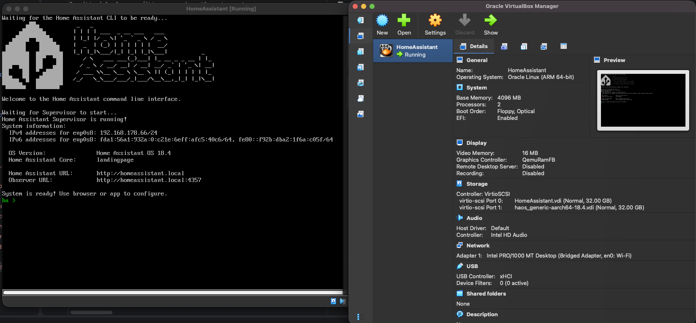
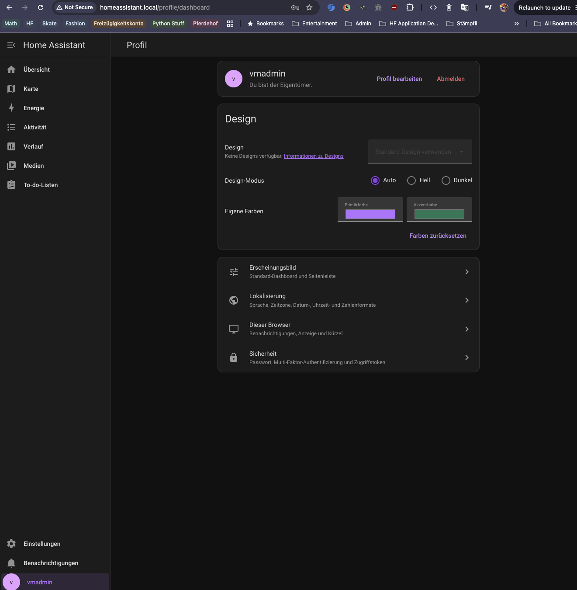

# 05B - HomeAssistant Installation
**Anforderungen:**
Sie haben sich über die Möglichkeiten von ESPHome und HomeAssistant informiert. Wo liegen die Grenzen, wie unterscheidet es sich von anderen Tools, welche Anderen Tools gibt es überhaupt? Wo liegen die Unterschiede?  
Home Assistant auf einem Raspberry Pi oder virtuel installiert und konfiguriert. Installation und Konfiguration im Portfolio festgehalten.  
Aus dem HA ein Programm auf den ESP geladen.

**KI-Deklaration:** Keine KI verwendet.

## Installation
Der HomeAssistant wurde als Virtualbox auf einem MacBook installiert.  
Requirement: VirtualBox muss installiert werden. Dies kann sehr einfach per homebrew gemacht werden:
```brew install --cask virtualbox```  
Danach kann man 1:1 der Installationsanleitung folgen: https://www.home-assistant.io/installation/macos/
Bei der Konfiguration empfielt sich, etwas mehr RAM und Diskspace zu geben. Das Resultat:



Als nächstes wurde eine Initiale Konfiguration vorgenommen nach https://www.home-assistant.io/getting-started/onboarding/.

