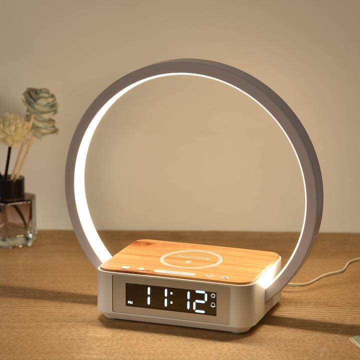

# Initialisierungsbericht
Autor: Loris Leuenberger, 25B

| Initialisierung | |
|---|---|
| **Projektname:** | Nachttischlampe mit Uhr, Wecker und Luftqualitätsanzeige |
| **Ausgangslage** | Ich habe morgens Mühe, aufzustehen wenn der Wecker klingelt. Oft werde ich mitten aus dem Tiefschlaf gerissen und neige dann dazu, lange zu schlummern. |
| **Projektziele:** | Ich möchte Device, welches mich auf langsame natürliche Weise weckt, und welches mich dazu forciert, wach zu werden und keinen easy schlummer Button hat. Zudem möchte ich ein All-in-One Gerät welches viele Funktionen bietet, ohne meinen Nachttisch zu überfüllen.  Dieses Gerät würde in etwa so aussehen     Folgende Funktionalitäten sind das Ziel:  - Das ganze Device ist an den HomeAssistant angebunden und kann dementsprechend automatisiert werden  - Eine dimmbare LED Lampe mit WRGB Optionen - Ein kleines Display mit einer Zeitanzeige und Co2 Gehalt der Luft - Eingebauter Lautsprecher - Weckerfunktion: Sowohl Lampe und Sound werden auf festgelegten Zeitpunkt hin heller/lauter. - Wecker abstellen Minigame: Eine Abfolge an Pfeilen erscheint auf dem Display und muss über ein integriertes D-Pad eingegeben werden damit der Wecker abstellt. Als Backup/Alternative kann der Wecker über HomeAssistant gestoppt werden. |
| **Abgrenzungen:** | Im Fokus hier steht die Technische/Funktionelle Ausarbeitung. Ich behalte mir vor, am Aussehen/Design des Gerätes Änderungen vorzunehmen während der Umsetzung/Testing. Z.B. kann ich mir auch vorstellen, die LEDs oben an meinem Bettrahmen anzumachen oder ggf. noch mehr Lampen in meinem Zimmer an die Wecker Funktionalität zu koppeln. Ein z.B. 3D gedrucktes Gehäuse wäre eine super Sache, ist aber nicht Priorität. |
| **Meilensteine** | Folgende Meilensteine gibt es in dem Projekt:  • Lieferung der Hardware • Zusammenbauen der Komponenten • Installation der Software • Test der verschiedenen Funktionen durchgeführt |
| **Termine** | KW48 2026: Lieferung der Hardware KW49 2026: Zusammenbauen der Komponenten KW50 2026: Installation der Software KW51 2026: Test der verschiedenen Funktionen durchgeführt KW51 2026: Projektabgabe |
| **Kosten** | Geschätzte Materialkosten: **ca. CHF 100 - 150** (ohne optionales Gehäuse / 3D-Druck). Der genaue Betrag kann variieren je nach Versandkosten etc. |
| **Personenaufwand** | 1 Projektmitglied: Loris Leuenberger. Geplanter Aufwand: ca. 15–25 Stunden für Planung, Beschaffung, Aufbau, Programmierung, Integration und Testing. |
| **Sachmittel** | Ich habe mir von AI helfen lassen und das ganze so gut wies geht überprüft. Es kann aber sein, dass noch kleinere Teile dazukommen: - 1× ESP32-S3 DevKitC-1 N8R8 als zentrale Steuereinheit - 1× SK6812 RGBW LED-Streifen (5 V, ca. 1 m) - 1× SN74AHCT125 Pegelwandler für die LED-Datenleitung - 1× OLED-Display (1,3 Zoll, 128 × 64 Pixel, I²C) - 1× Sensirion SCD41 CO₂-Sensor - 1× 5-Wege-Navigationsmodul als D-Pad - 1× MAX98357A I²S-Audioverstärker - 1× Lautsprecher (4 Ω, 3 W) - 1× 5-V-Netzteil (voraussichtlich 5 A, abhängig von der LED-Anzahl) - 1× 330-Ω-Widerstand und 1× 1000-µF-Kondensator - Sicherung, Anschlussbuchse, Kabel, Steckverbinder und Verteilerplatine |
| **Auftraggeber** | Thomas Staub |
| **Projektleiter** | Loris Leuenberger |
| **Projektmitglieder** | Loris Leuenberger |
| **Projektausschuss** | Thomas Staub, Loris Leuenberger |
| **Verteiler** | Thomas Staub, Loris Leuenberger |
